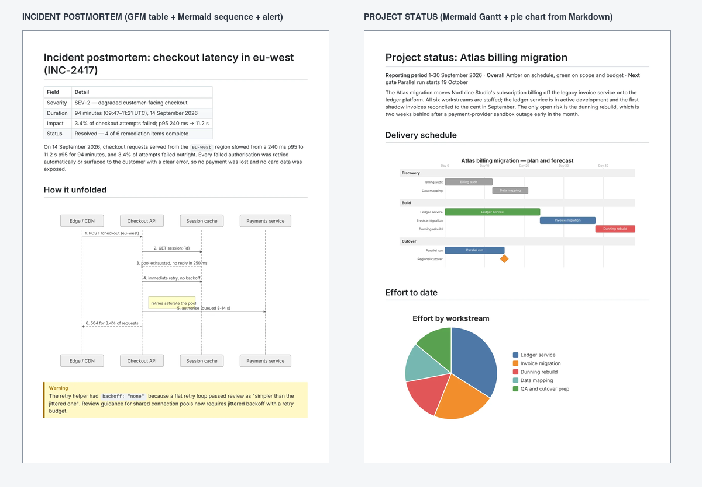

# makesPDF — Markdown to PDF for VS Code

Export any Markdown file to a cleanly typeset, accessible, archive-grade PDF with one command. Rendering runs on [makesPDF.com](https://makespdf.com?ref=vscode) — no headless Chromium, no LaTeX, and no local toolchain to maintain.

*Real PDFs rendered straight from Markdown by makesPDF: GFM tables, native vector Mermaid diagrams, alerts, and embedded fonts.*

## Why makesPDF?

- **GitHub Flavored Markdown in, typeset PDF out.** Tables, syntax-highlighted fenced code blocks, task lists, nested lists, GFM alerts, footnotes, inline images, Mermaid diagrams (20 diagram types rendered as native vector graphics), Graphviz DOT / declarative graphs, colour emoji, and CJK / Hebrew fallback scripts.
- **Nothing to install locally.** No headless browser, no native binaries, no font wrangling. Open a `.md` file and export.
- **About a second, end to end.** A deterministic layout engine renders typical documents in about a second without headless-browser cold-start penalties or AI in the render path.
- **PDF/A-2A + PDF/UA-1 compliant by default.** Every output ships with a tagged structure tree (headings, tables, lists, figure alt text), embedded subset fonts, and an sRGB ICC profile — checked against veraPDF 1.28.2 on every release via our fixture suite.
- **Identical output across machines.** Same Markdown produces the same PDF on macOS, Windows, Linux, and CI with bundled fonts (Inter, Noto Sans, Cousine).
- **Configurable layout and YAML frontmatter.** Choose A3, A4, A5, Letter, or Legal, margins in points, font family, and font size (6–24pt) in VS Code settings or per-file YAML frontmatter.
- **Grows into automation and AI agents.** The same service powers high-volume templates (invoices, quotes, reports, statements) over a REST API, CLI, and hosted MCP server. See [makespdf.com/docs](https://makespdf.com/docs?ref=vscode).

## Getting started

1. **Install** the extension from the [VS Code Marketplace](https://marketplace.visualstudio.com/items?itemName=Lecstor.makespdf-vscode-plugin).
2. **Open any `.md` file** and run **makesPDF from markdown** — from the Command Palette, the PDF icon in the editor title bar, or the right-click menu.

That's it. The generated PDF is saved next to your source file and opened in your system viewer.

Using a VS Code-based editor that doesn't use the Microsoft Marketplace? Cursor, Windsurf, VSCodium and other forks install the extension from [Open VSX](https://open-vsx.org/extension/Lecstor/makespdf-vscode-plugin).

Documents up to 20 pages render out of the box, rate-limited to 60/hour and 200/day per IP. For longer documents and higher limits, add an API key from [makespdf.com/settings/api-keys](https://makespdf.com/settings/api-keys) to the `makespdf.apiToken` setting (Cmd/Ctrl + , → search "makespdf"). With a key configured, renders go through your account: no per-IP limit, no per-render page cap (other than the 200KB Markdown input cap), and your PDFs are persisted to `makespdf.com/settings/renders` for re-download.

**Local images are embedded on export.** An image referenced by a relative or absolute filesystem path (`` or an HTML image tag) is read from disk and embedded as a `data:` URI before upload, so the service can render it without filesystem access. If any local image cannot be embedded — the file is missing or unreadable, or larger than 5MB — the export stops without writing a PDF and an error dialog names each failed reference (up to ten, then a count) and its reason, so you can fix or remove it and export again. `http(s)` URLs are left for the service to fetch.

See [makespdf.com/pricing](https://makespdf.com/pricing) for plan details. PDFs on the Free and Hobbyist plans include a small `makespdf.com` link at the bottom of the page — paid plans remove it.

## Settings

| Setting | Default | Description |
|---------|---------|-------------|
| `makespdf.serviceUrl` | `https://makespdf.com` | URL of the PDF service. Change this only if you're running makesPDF self-hosted. |
| `makespdf.apiToken` | `""` | Optional. Leave blank for the default per-IP limits (60/hour, 200/day, 20 pages per render). Paste a key to lift the limits and persist renders. Get one at [makespdf.com/settings/api-keys](https://makespdf.com/settings/api-keys). |
| `makespdf.pageSize` | `A4` | A3, A4, A5, Letter, or Legal. |
| `makespdf.fontFamily` | `Inter` | Inter or NotoSans. |
| `makespdf.fontSize` | `10` | Font size in points (6–24). |
| `makespdf.margins` | `[40, 40, 40, 40]` | Page margins in points `[top, right, bottom, left]`. |

## Sending feedback

When an export fails, the error message has a **Report problem** button. You can also run **makesPDF: Send feedback** from the Command Palette at any time to send a problem, an idea or praise.

Feedback is sent to makesPDF (`POST /api/v1/feedback` on your `makespdf.serviceUrl`) and read by the makesPDF team. Each message contains:

- the text you type (please don't paste document content into it);
- the kind you picked: problem, idea or praise;
- for **Report problem** only, a few facts about the failed export: the HTTP status, the server's error code if it returned one, your page size, font family and font size settings, and the size of the document in bytes;
- the extension's name and version (`X-MakesPDF-Client`), and your API key if you have set `makespdf.apiToken`, so the feedback is linked to your account. Without a key, or if the server rejects your key, it is sent anonymously.

Your Markdown, its file name and its path are never sent with feedback. The service stores your message with a daily-salted hash of your IP address and your country code, and keeps it until the makesPDF team deletes it. Your IP address is also used, unhashed, for rate limiting. If sending fails, the error message links to [GitHub issues](https://github.com/makesPDF/makespdf-vscode-plugin/issues) instead.

## Links

- **Website:** https://makespdf.com
- **API docs:** https://makespdf.com/docs
- **Marketplace listing:** https://marketplace.visualstudio.com/items?itemName=Lecstor.makespdf-vscode-plugin
- **Source / issues:** https://github.com/makesPDF/makespdf-vscode-plugin

## Contributing

See [CONTRIBUTING.md](./CONTRIBUTING.md) for development setup, build commands and tests.

## License

[MIT](./LICENSE)
